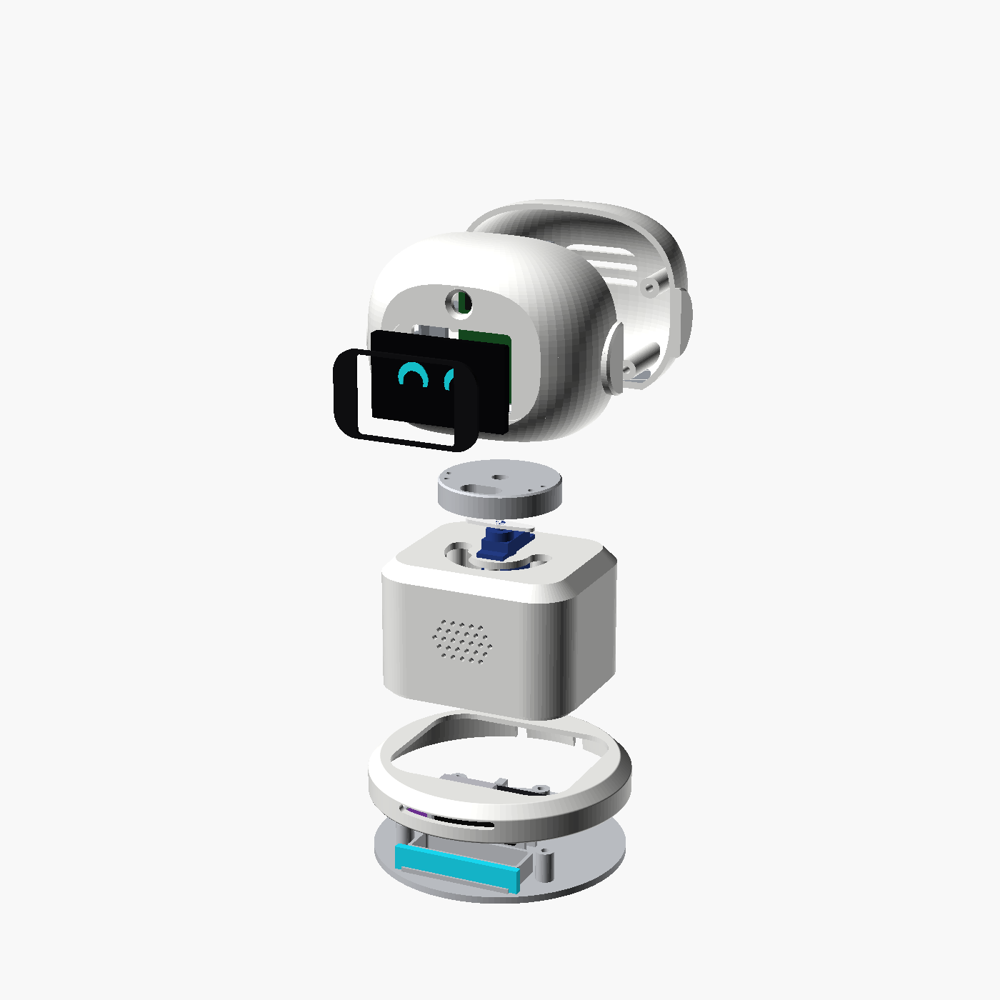
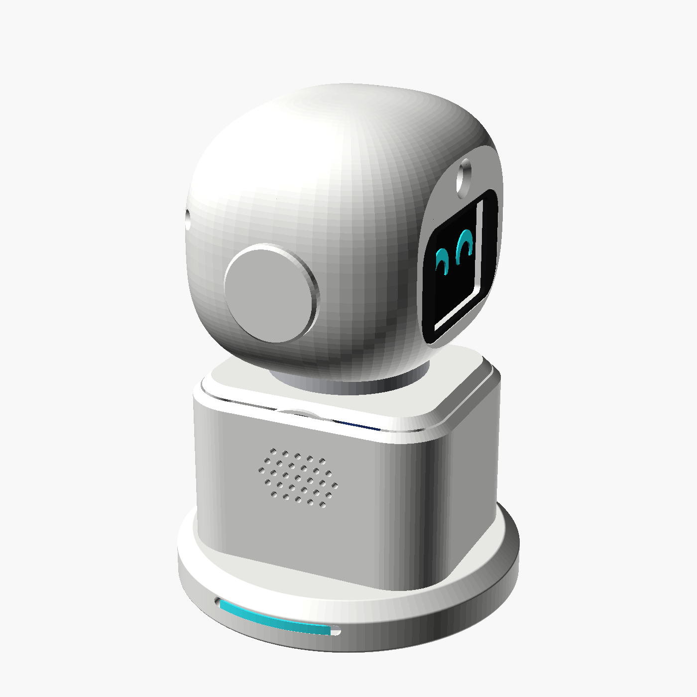
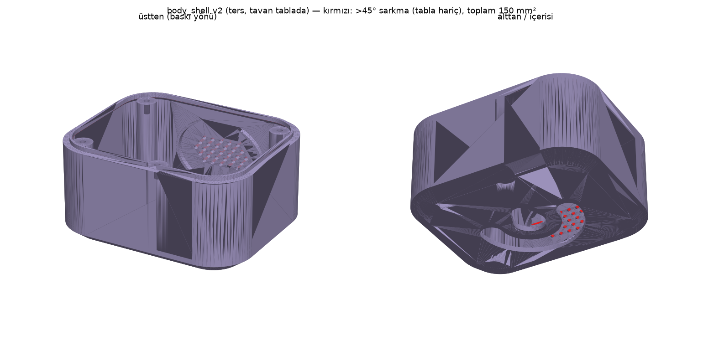
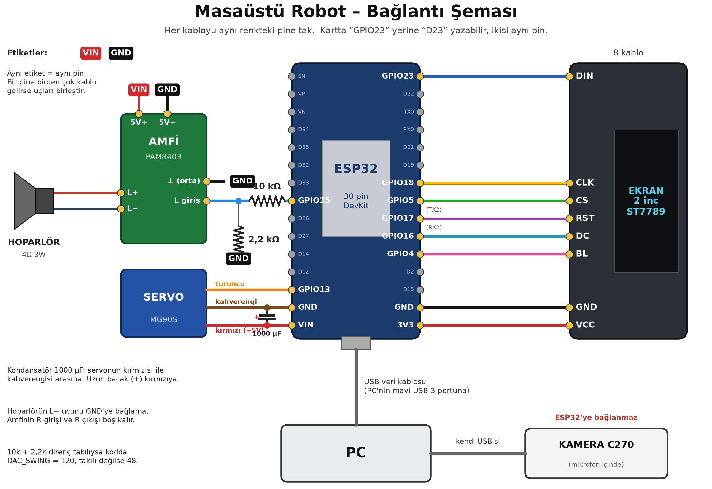
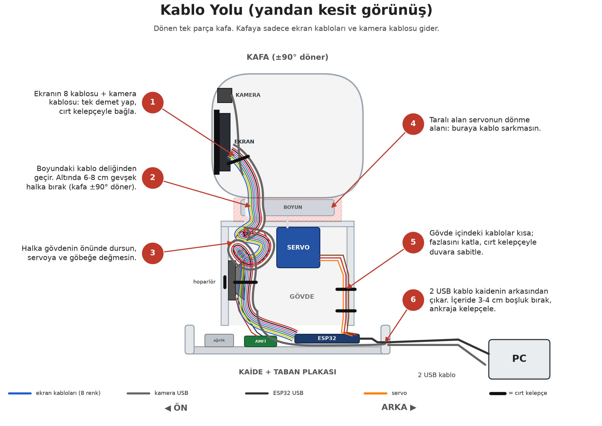

# Masaüstü Robot v1 (ESP32 + Grok)

Masanın üstünde duran, kafası sağa-sola dönen, gözleri ekran olan, seni kamerayla takip edip Grok ile **Türkçe sesli sohbet** eden küçük bir robot. Beyin Windows PC'de çalışır; robotun içindeki ESP32 ekranı, servoyu ve hoparlörü sürer. Bütün plastik parçalar 3D yazıcıyla basılır (OpenSCAD parametrik model).

> **English summary:** A 3D-printed desktop companion robot. A Windows PC runs face tracking (MediaPipe, Logitech C270) and voice chat with xAI Grok (speech-to-text, LLM, TTS); an ESP32 drives a 2" ST7789 "eyes" display, an MG90S head-pan servo and a speaker through a PAM8403 amp fed by the ESP32's internal DAC (GPIO25), all over a single USB serial link (921600 baud). No USB hub: the camera and ESP32 use two separate USB cables. Parametric OpenSCAD source, ready STLs/3MF, Arduino firmware and the Python app are included. Docs are in Turkish. MIT licensed.


| Patlatılmış görünüm | Kafa +90° | Arka |
|---|---|---|
|  |  |  |

| Gövde | Kafa önü (iç) |
|---|---|
|  |  |

> Görseller OpenSCAD render'ıdır.

## Dosyalar ne işe yarar?

| Dosya / klasör | Ne |
|---|---|
| `3d_parcalar/` | Basılacak 9 parça (STL), baskı yönünde hazır. Numara = alttan üste sıra |
| `tum_parcalar.3mf` | Bütün parçalar tek dosyada (toplu bakış) |
| `yeni_3parca_tek_tabla.3mf` | Yenilenen 3 parça (gövde, kafa önü, ekran braketi) tek tablada |
| `robot_model.scad` | OpenSCAD parametrik model (bütün parçaların kaynağı) |
| `MONTAJ_KILAVUZU.md` | Baskı ayarları, montaj sırası, bağlantılar, test listesi |
| `PARCA_LISTESI.md` / `parca_listesi.pdf` | Satın alınacak parçalar, link ve fiyatlar |
| `gorseller/` | Render'lar, bağlantı şeması ve kablo yolu çizimi |
| `yazilim/KURULUM.md` | Yazılım kurulumu adım adım |
| `yazilim/esp32_kodu/robot_kodu/` | ESP32'ye yüklenecek Arduino kodu (`robot_kodu.ino`) |
| `yazilim/pc_panel/` | PC programı: `panel_baslat.bat` ile açılır |
| `araclar/` | Geliştirici betikleri (STL üretme/kontrol, parça listesi, şema çizimi). Robotu kullanmak için gerekmez |

### STL parçaları

| Dosya | Parça |
|---|---|
| `1_taban_plakasi.stl` | En alttaki plaka (ESP32, amfi, ağırlık kabı) |
| `2_kaide.stl` | Yuvarlak kaide halkası |
| `3_govde.stl` | Gövde kutusu (servo, hoparlör) |
| `4_boyun.stl` | Servoya takılan boyun göbeği |
| `5_kafa_on.stl` | Kafanın ön yarısı |
| `6_kafa_arka.stl` | Kafanın arka kapağı |
| `7_ekran_braketi.stl` | Ekranı tutan braket |
| `8_kamera_braketi.stl` | Kamera kartını tutan braket |
| `9_vizor_siyah.stl` | Ekranın önündeki siyah çerçeve (siyah PLA) |

## Özellikler

- **Yüz takibi:** C270 kamerayla yüzü bulur (MediaPipe), kafayı servoyla yüze çevirir; kimse yoksa etrafı tarar, sonra dinlenir.
- **Grok ile sesli sohbet:** C270 mikrofonundan dinler (VAD), Grok STT ile yazıya çevirir, Grok ile cevap üretir, Grok (veya Edge) sesiyle konuşur. Hava durumu, döviz ve web araması gibi araçları kullanabilir, kalıcı not tutabilir.
- **Ekran gözler:** 2" ST7789 ekranda animasyonlu gözler; göz kırpma ve ruh hâli (mutlu / kızgın / normal).
- **Kafa dönüşü (pan):** MG90S servo ile ±90°, yumuşak hızlanma/yavaşlama.
- **Robotun kendi hoparlörü:** Ses PC'den seri portla ESP32'ye akar, ESP32 dahili DAC (GPIO25) → PAM8403 → 40 mm hoparlör.
- **Kontrol paneli:** `panel.py` (customtkinter) ile durum, ayarlar ve test.
- Hub yok: PC'ye 2 ayrı USB kablo (kamera + ESP32). Harici güç adaptörü gerekmez.

Ölçüler (montajlı): yükseklik ~160 mm, kaide Ø114 mm, kafa 109 × 82 mm.

## Parça listesi

| # | Parça | Adet | Nereden | Not |
|---|---|---|---|---|
| 1 | 2" IPS LCD ekran 240×320 ST7789 | 1 | [Robotistan](https://www.robotistan.com/2-inc-lcd-ekran-modulu) | Göz ekranı, SPI, PCB 58×35 mm |
| 2 | Hoparlör 4 Ω 3 W 40 mm | 1 | [Motorobit](https://www.motorobit.com/hoparlor-4-ohm-3w-40mm) | Gövde önündeki ızgaranın arkası |
| 3 | MG90S servo motor 180° | 1 | [Robotistan](https://www.robotistan.com/mg90s-servo-motor) | Kafa sağ-sol ±90° |
| 4 | 40 pin dişi-dişi jumper kablo 200 mm | 1 | [Robotistan](https://www.robotistan.com/40-pin-ayrilabilen-disi-disi-f-f-jumper-kablo-200-mm) | ESP32 bağlantıları |
| 5 | PAM8403 3 W 2 kanal mini amfi | 1 | [Motorobit](https://www.motorobit.com/3w-2-kanal-mini-amfi-devresi-pam8403) | Sadece sol kanal; kart ~21×18 mm |
| 6 | Logitech C270 HD webcam (mikrofonlu) | 1 | [Trendyol](https://www.trendyol.com/logitech/c270-960-001063-mikrofonlu-hd-webcam-p-2378692) | Kasası sökülür, kartı kafaya girer. **C270 olmalı** (C210/C310 değil) |
| 7 | ESP32 DevKit 30 pin | 1 | - | Kaidedeki yuva 30 pin karta göre |
| 8 | 1000 µF 16 V elektrolit kondansatör | 1 | [Robotistan](https://www.robotistan.com/16v-1000uf-kondansator-paketi-5-adet) | Servo 5V-GND arasına |
| 9 | 10 kΩ + 2,2 kΩ direnç | 1+1 | - | Amfi girişi gerilim bölücü (önerilir) |

Küçük malzemeler: micro-USB **data** kablosu (≥1,5 m, **90° açılı fiş**), M3 kendinden kılavuzlu vidalar (M3×8/10/12/18) ve birkaç M2×6, lehim, makaron, sıcak silikon, çift taraflı köpük bant, cırt kelepçe, ön ağırlık kabı için 40-70 g ağırlık (M8 somun / bozuk para), isteğe bağlı 4 silikon ayak. Filament: ~250 g beyaz PLA, biraz siyah PLA (vizör), ~60 g herhangi renk PLA (iç parçalar).

> WS2812B LED çubuğu bu sürümde **opsiyonel** (şimdilik çıkarıldı). Firmware'de LED desteği duruyor, takılı değilse sorun olmaz. Fiyatlı ayrıntılı liste: [PARCA_LISTESI.md](PARCA_LISTESI.md) / [parca_listesi.pdf](parca_listesi.pdf).

## Baskı ayarları

Bambu Lab A2L ile hazırlandı. Genel: PLA, 0,4 nozül, 0,2 mm katman, 3 duvar (vida delikleri için 4 daha iyi), üst/alt 5 katman, %15 gyroid dolgu. STL'ler baskı yönünde hazır.

| Dosya (`3d_parcalar/`) | Renk | Yön | Destek |
|---|---|---|---|
| `3_govde.stl` | Beyaz | **Ters** (tavan tablada) | **Yok** |
| `5_kafa_on.stl` | Beyaz | Bölme yüzü tablada | **Ağaç (tree) destek, sadece tabladan (build plate only)** |
| `6_kafa_arka.stl` | Beyaz | Bölme yüzü tablada | Ağaç destek, içe |
| `7_ekran_braketi.stl` | Gri/herhangi | Arka yüz tablada | **Yok** |
| `9_vizor_siyah.stl` | **Siyah PLA** | Düz | Yok (%100 dolgu) |
| `2_kaide.stl` | Beyaz | Ters | Yok |
| `1_taban_plakasi.stl` | Gri/herhangi | Düz | Yok (amfi cebi büyütülmüş sürüm) |
| `4_boyun.stl` | Gri/beyaz | Üst yüz tablada | Yok |
| `8_kamera_braketi.stl` | Gri/herhangi | Arka yüz tablada | Yok |

- `yeni_3parca_tek_tabla.3mf`: yenilenen 3 parça (5_kafa_on, 3_govde, 7_ekran_braketi) tek tablaya dizilmiş hâli.
- `tum_parcalar.3mf`: bütün parçalar tek dosyada (toplu bakış için).
- Model parametrik: `robot_model.scad` (OpenSCAD). Tüm STL ve render'ları yeniden üretmek için `araclar/hepsini_uret.sh`.

## Bağlantı özeti





**USB:** C270 kendi kablosuyla PC'ye; ESP32 micro-USB data kablosuyla PC'nin USB 3 portuna. Servo ve amfi ESP32'nin VIN (5 V) pininden beslenir.

| ESP32 pini | Bağlantı |
|---|---|
| GPIO18 | Ekran SCK |
| GPIO23 | Ekran MOSI/DIN |
| GPIO5 | Ekran CS |
| GPIO16 | Ekran DC |
| GPIO17 | Ekran RST |
| GPIO4 | Ekran BL (arka ışık) |
| 3V3 | Ekran VCC |
| GPIO13 | Servo sinyal (turuncu) |
| GPIO25 (DAC1) | PAM8403 L-IN (önerilen: 10 kΩ / 2,2 kΩ bölücü üzerinden) |
| VIN (5 V) | Servo kırmızı, PAM8403 5V+ |
| GND | Ortak GND (ekran, servo, amfi giriş ve güç GND) |
| GPIO27 | (Opsiyonel) WS2812B DIN, 330 Ω seri |

```
ESP32 GPIO25 ──[10 kΩ]──┬── PAM8403 L-IN        PAM8403 L+/L− ── hoparlör (L− GND'ye BAĞLANMAZ)
                        └──[2,2 kΩ]── GND
1000 µF: servonun 5V-GND uçlarına, + ucuna dikkat
```

Bölücü kullanırsan firmware'de `DAC_SWING` 120, kullanmazsan 48 (varsayılan). Ayrıntılar ve montaj sırası: [MONTAJ_KILAVUZU.md](MONTAJ_KILAVUZU.md).

## Yazılım kurulumu

Ayrıntılı adımlar: [yazilim/KURULUM.md](yazilim/KURULUM.md).

1. **ESP32 firmware:** Arduino IDE 2 + "esp32 by Espressif" kart paketi. Kütüphaneler: `ESP32Servo`, `Adafruit ST7735 and ST7789 Library`, `Adafruit GFX`, `Adafruit NeoPixel`. `yazilim/esp32_kodu/robot_kodu/robot_kodu.ino`'yu aç, kart **ESP32 Dev Module**, portu seç, yükle (gerekirse BOOT'a basılı tut). Sonra Arduino IDE'yi kapat.
2. **Python 3.11** (64-bit, "Add to PATH" işaretli). 3.13 kullanma (MediaPipe desteklemiyor).
3. **Grok API anahtarı:** [console.x.ai](https://console.x.ai)'den anahtar al, Windows'a ortam değişkeni olarak kaydet:
   ```
   setx XAI_API_KEY "xai-BURAYA-ANAHTARIN"
   ```
   Anahtarı `config.yaml`'a veya depoya **yazma**.
4. **Çalıştır:** `yazilim/pc_panel/panel_baslat.bat` (kontrol paneli) ya da `baslat.bat`. İlk açılışta sanal ortamı kurar ve paketleri indirir.
5. Ayarlar (karakter, ses, takip hassasiyeti, model): `yazilim/pc_panel/config.yaml`.

## Klasör yapısı

```
├── 3d_parcalar/                # 9 STL (1_taban_plakasi ... 9_vizor_siyah)
├── tum_parcalar.3mf            # Tüm parçalar tek dosya
├── yeni_3parca_tek_tabla.3mf   # Yenilenen 3 parça tek tabla
├── robot_model.scad            # OpenSCAD parametrik model
├── gorseller/                  # Render'lar, baglanti_semasi.png, kablo_yolu.png
├── MONTAJ_KILAVUZU.md          # Baskı, montaj, bağlantı, test listesi
├── PARCA_LISTESI.md / parca_listesi.pdf
├── araclar/                    # Geliştirici betikleri (hepsini_uret.sh, stl_kontrol.py, ...)
└── yazilim/
    ├── KURULUM.md
    ├── esp32_kodu/robot_kodu/  # Arduino kodu (robot_kodu.ino + eye_types.h)
    └── pc_panel/               # PC programı (panel_baslat.bat, baslat.bat, config.yaml)
```

## Notlar

- Model ürün sayfası ölçülerine göre tasarlandı; ilk baskıdan sonra ekran ve kamera oturuşunu kontrol et (parametreler `.scad` başında).
- Grok API kullanımı ücretlidir; bir soru-cevap kabaca 0,005 $ (bkz. KURULUM.md).

## Lisans

[MIT](LICENSE)
